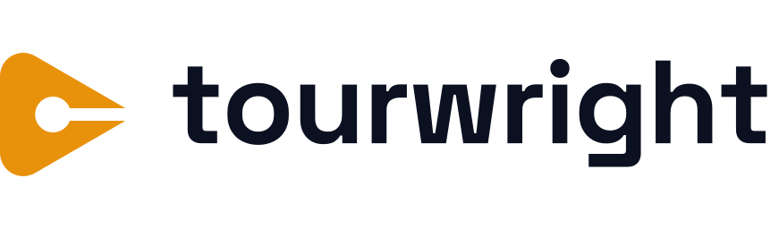
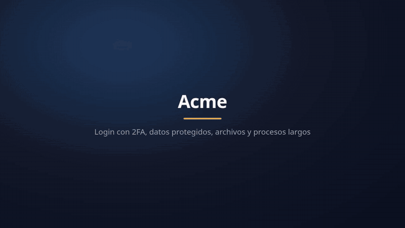

<h1 align="center">
  <picture>
    <source media="(prefers-color-scheme: dark)" srcset="brand/logo-horizontal-dark.svg">
    
  </picture>
</h1>

[](https://www.npmjs.com/package/tourwright)
[](https://github.com/CXmiloxx/tourwright/actions/workflows/ci.yml)
[](LICENSE)
[](docs/AGENTS.md)

**Videos guiados y narrados de tu producto, sin editar.** Haces el recorrido por tu app una vez, o le pides el
video a tu agente de IA: Tourwright escribe el guion, graba un navegador de verdad en un marco de estudio, lleva
la mirada a cada elemento, habla con una voz natural y entrega un `.mp4` con subtítulos, capítulos y miniatura.
Si la interfaz cambia, lo vuelves a generar. Hecho para personas *y* para agentes de IA, en cualquier servidor:
de un portátil a un clúster.

*[Read in English](README.md)*

<p align="center">
  <a href="docs/demo/demo.mp4"></a>
  <br><sub>Hecho por Tourwright a partir de <a href="examples/app.yaml">examples/app.yaml</a>, sin nadie en el teclado. <a href="docs/demo/demo.mp4">▶ Verlo con sonido</a> (77 s)</sub>
</p>

```yaml
# recorrido.yaml
title: Tu primera factura
voice: salome
baseUrl: https://app.ejemplo.com
steps:
  - goto: /facturas/nueva
  - title: { text: Tu primera factura, subtitle: Paso a paso }
  - say: Primero eliges el <b>cliente</b>.
  - click: { role: combobox, name: Cliente }
  - say: Después guardas. Eso es todo.
  - click: { role: button, name: Guardar }
```

```bash
tourwright render recorrido.yaml   # → videos/recorrido/recorrido.mp4 (+ captions.srt/.vtt, .jpg, .json)
```

## Por qué Tourwright

Los grabadores de pantalla (Loom) y las herramientas de demos interactivas (Arcade, Supademo, Scribe) necesitan
a alguien que grabe, y cada rediseño obliga a grabar otra vez. Los videos de Tourwright son **código**:

| | Grabador de pantalla | SaaS de demos | **Tourwright** |
|---|---|---|---|
| Volver a grabar tras un cambio de la interfaz | a mano | a mano | `tourwright render` |
| Sabe cuándo un video quedó desactualizado | no | no | `tourwright check` en CI dice qué paso se rompió y el arreglo |
| Narración | tu voz, varias tomas | ninguna o aparte | voz sintética, muchas voces, con o sin internet |
| El mismo recorrido para 50 clientes o idiomas | 50 grabaciones | 50 demos | un guion con `{{variables}}` |
| Datos personales en pantalla | editarlos | editarlos | `mask` los cambia por datos inventados |
| Dónde vive | la nube de un proveedor | la nube de un proveedor | tu repositorio y tus servidores; MIT |
| Un agente de IA puede hacerlo | no | no | servidor MCP y plugin de Claude Code |

## Qué hace

- **Recorridos por un sitio web**: Chromium real, cursor animado y suave, onda en cada clic, marcos, foco,
  globos que señalan, acercamientos de cámara, arrastrar y soltar, datos personales desenfocados, carteles y
  subtítulos con tus colores y tu logo.
- **Foco guiado**: el recorrido que muestra una app la primera vez que entras. Todo se oscurece menos el
  elemento, un anillo lo marca, un globo con un contador `2/4` lo explica y la cámara se acerca, justo en la
  palabra que está diciendo la voz.
- **Diapositivas narradas**: carteles, imágenes (con paneo o zoom lento), HTML, fundidos. Sin sitio web.
- **La voz que quieras**: [Pocket TTS](https://github.com/kyutai-labs/pocket-tts) (sin internet, abierta y natural:
  `tourwright install --pocket`), [Piper](https://github.com/rhasspy/piper) (sin internet, open source, ligera),
  voces neuronales de Microsoft Edge, cualquier servidor TTS compatible con OpenAI (OpenAI,
  Kokoro, LocalAI…) o tu propio comando. Cada oración queda en caché: volver a grabar no la pide otra vez.
- **Un reparto, y cómo se dice cada frase**: varias voces por video; velocidad, tono y volumen por frase en
  cualquier motor; pausas exactas (`[[1s]]`); diccionario de pronunciación; perfiles de sonido (cálido,
  radio, pódcast…); sonidos de clic, tecleo y otros efectos; música con fundidos.
- **Guiones que crecen contigo**: variables (`{{nombre}}`, también desde la CLI o la API), bloques
  reutilizables, repeticiones, condiciones y pasos que pueden fallar. Un guion, muchos videos.
- **Plugins**: acciones, motores de voz y voces nuevas como módulos pequeños ([docs/PLUGINS.md](docs/PLUGINS.md)).
- **Edición automática**: se recortan las cargas, las esperas largas y lo que tarda la voz; una narración
  nunca pisa a otra; la música de fondo baja sola cuando alguien habla.
- **Entregables**: `.mp4` H.264/AAC con capítulos y los subtítulos dibujados, `.srt`, `.vtt`, miniatura y un manifiesto
  JSON (duración, capítulos, subtítulos) para automatizar.
- **Cuatro entradas**: CLI, API HTTP con cola y webhooks, servidor MCP para agentes, librería de Node.
- **Escala horizontal**: API sin estado con réplicas, tantos workers como servidores tengas, cola en
  Redis/BullMQ y archivos en cualquier S3. O un solo proceso con una carpeta, hasta en una Raspberry Pi.

## Instalar

### Docker (recomendado)

```bash
docker run --rm -v "$PWD:/work" -w /work ghcr.io/cxmiloxx/tourwright render examples/slides.yaml --out videos/
```

El servicio completo (API + 2 workers + Redis):

```bash
cp .env.example .env    # pon TOURWRIGHT_API_TOKENS
docker compose up -d --build
docker compose up -d --scale worker=6
```

### Desde npm (lo más rápido para probar)

Con Node.js 22 o superior, en Linux, macOS o Windows:

```bash
npm install -g tourwright
tourwright install                    # ffmpeg, Piper y voces, edge-tts, Chromium (sin root)
tourwright install --plan             # solo muestra qué usaría del PC y qué descargaría
tourwright config set quality fullhd  # tus valores por defecto: calidad, voz, fps… (tourwright config los lista)
tourwright record https://app.example.com --out tour.yaml   # haces el recorrido a mano: sale el guion y el video
tourwright guide tour.yaml --open     # el mismo recorrido como guía paso a paso con capturas (HTML, PDF, Markdown)
tourwright narrate tour.yaml --write  # tu IA (Claude, OpenAI, Ollama) reescribe la narración viendo las pantallas
tourwright translate tour.yaml --to en  # el mismo video en inglés (o pt, fr, de, it): tour.en.yaml
tourwright check videos/*.yaml        # qué videos se rompieron tras un despliegue, en qué paso, y el arreglo
tourwright fix tour.yaml --write      # pone los objetivos nuevos en el guion
tourwright render tour.yaml --step 7  # graba un solo paso con su voz, sin el video completo
tourwright install --pocket           # + Pocket TTS: voces naturales sin internet (cerca de 1 GB)
tourwright clean                      # cuánto ocupa cada parte; borra descargas y sobrantes
tourwright doctor                     # qué funciona en esta máquina
```

Sin instalar nada global: `npx tourwright <comando>`. Con pnpm: `pnpm add -g tourwright` (en la 2.0.0,
agrega `--no-optional`).

La cola en Redis y Claude para `narrate` son opcionales: instala `bullmq ioredis` o `@anthropic-ai/sdk` junto a
Tourwright cuando los uses (`npm install -g bullmq ioredis`). La imagen de Docker ya los trae.

### Sin Docker (Linux, macOS, Windows)

Con Node.js 22 o superior. `tourwright install` deja ffmpeg, Piper, voces, edge-tts y Chromium en
`TOURWRIGHT_HOME`, sin permisos de root ni de administrador; lo que el sistema ya tiene se respeta.

```bash
git clone https://github.com/CXmiloxx/tourwright && cd tourwright
./scripts/install.sh           # Linux / macOS (Windows: powershell -ExecutionPolicy Bypass -File scripts\install.ps1)
node bin/tourwright.js doctor  # qué funciona en esta máquina
npm link                       # opcional: el comando `tourwright`
```

Cada pieza se busca primero en el PC y solo se descarga si falta:

| | Linux (x64, arm64) | macOS (Intel, Apple Silicon) | Windows 10/11 (x64, ARM) |
|---|---|---|---|
| Chromium | Chrome, Edge o Chromium (apt, dnf, pacman, Raspberry Pi OS); si no, se descarga | Chrome, Edge o Chromium; si no, se descarga | Chrome o Edge; si no, se descarga |
| ffmpeg | `PATH`, Homebrew, Nix; si no, se descarga | Homebrew, MacPorts, Nix; si no, `brew install ffmpeg` | `PATH`, winget, scoop, Chocolatey, `C:fmpeg`; si no, se descarga |
| Piper (voces sin internet) | `PATH`, pip, pipx, conda; si no, se descarga | `PATH`, pip, pipx, conda; si no, `piper-tts` | `PATH`, pip, pipx, conda; si no, se descarga |
| Voces de Piper | caché de Hugging Face, `TOURWRIGHT_PIPER_VOICE_DIRS`; si no, se descargan | igual | igual |
| edge-tts (voces de Microsoft) | `PATH`, pip, pipx, conda; si no, se instala | igual | igual |
| Python (para edge-tts, Pocket, Whisper) | el 3.10–3.13 del sistema; si no, se descarga 3.12 | igual | igual (no el acceso directo de Microsoft Store) |
| Captura | `screen` con Xvfb (la más nítida); si no, `screencast` | `screencast` | `screencast` |

También se reutiliza un Chromium que dejó otra versión de Playwright o Puppeteer, y `CHROME_PATH`, `CHROME_BIN`
o `PUPPETEER_EXECUTABLE_PATH`. Los navegadores snap y Flatpak se descartan (su aislamiento bloquea a
Playwright). `TOURWRIGHT_SYSTEM_BROWSER=0` usa siempre el Chromium de Playwright. `tourwright doctor` muestra
qué encontró.

No se instala nada en el sistema: lo que se descarga queda en una sola carpeta (`TOURWRIGHT_HOME`), y los
paquetes de Python corren en un entorno virtual, así que el tuyo nunca se cambia. Para desinstalar, borra esa
carpeta.

Con `Xvfb` (`apt install xvfb`, solo Linux) la captura es la más nítida; sin él, Tourwright graba sin pantalla
(screencast), que funciona donde corra Chromium. Los clientes de la API HTTP o de MCP pueden estar en
cualquier sistema.

## Usar

De un sitio a un video, sin buscar selectores a mano:

```bash
tourwright explore https://app.ejemplo.com/login --draft app.yaml   # pide el login y escribe el guion
tourwright render app.yaml --dry-run                               # prueba cada paso en segundos
tourwright render app.yaml --open                                  # el video, en ./videos/app/
```

El borrador recorre cada sección del sitio con una narración tomada de sus páginas; ajústala con tus palabras.
Las credenciales se piden una vez, no se muestran y nunca quedan en el guion (`tourwright secret list`;
`tourwright forget` las borra).

```bash
tourwright init video.yaml              # un guion de ejemplo
tourwright validate video.yaml
tourwright render video.yaml --dry-run  # ensayo: corre todo rápido, sin voz ni video (prueba los selectores)
tourwright render video.yaml --safe     # el mismo ensayo sin presionar nada: ni registros, ni pagos, ni SMS reales
tourwright render video.yaml --keep     # guarda la grabación: tourwright recompose videos/video lo rearma sin navegador
tourwright render video.yaml --quality fullhd --voice gonzalo --out salida/
tourwright voices                       # las voces de este servidor
tourwright install-voice es_ES-sharvard-medium
tourwright say "Hola" --voice claude --out hola.wav
```

El formato del guion, cada acción y las voces: **[docs/SCRIPTS.md](docs/SCRIPTS.md)**.

### Claude Code y otros agentes

Como plugin de Claude Code (el servidor MCP y un skill que escribe, prueba y graba el guion):

```text
/plugin marketplace add CXmiloxx/tourwright
/plugin install tourwright@tourwright
```

Cualquier otro cliente MCP: `{ "mcpServers": { "tourwright": { "command": "npx", "args": ["-y", "tourwright", "mcp"] } } }`.

### GitHub Action

Vuelve a grabar tus recorridos en cada versión, o falla el build cuando un despliegue rompió uno:

```yaml
- uses: CXmiloxx/tourwright@v2
  with:
    scripts: videos/*.yaml
    command: check            # o render: los videos quedan como artefacto del workflow
  env:
    TOURWRIGHT_SECRET_APP_PASSWORD: ${{ secrets.APP_PASSWORD }}
```

### API HTTP, agentes (MCP) y librería

Igual que en el [README en inglés](README.md#use-it): `tourwright serve`, `tourwright mcp` y
`import { render } from 'tourwright'`. Detalle en [docs/API.md](docs/API.md) y [docs/AGENTS.md](docs/AGENTS.md).

## Escalar

| Tamaño | Cómo |
|---|---|
| Una máquina | `tourwright serve --worker`: cola en una carpeta, archivos en disco |
| Una máquina grande | `docker compose up --scale worker=N`: cola en Redis, volumen compartido |
| Varias máquinas | Réplicas de la API detrás de un balanceador, workers donde sea, mismo Redis y mismo bucket S3 |
| Kubernetes | [`deploy/kubernetes/tourwright.yaml`](deploy/kubernetes/tourwright.yaml), workers con autoescalado |

Cada worker graba `TOURWRIGHT_CONCURRENCY` videos a la vez (un Chromium y un ffmpeg cada uno: calcula 1–2 CPU
y ~1 GB de RAM por video en 720p). Corren con prioridad baja de CPU y disco, para no ahogar un servidor
compartido. Más en [docs/DEPLOYMENT.md](docs/DEPLOYMENT.md) y [docs/CONFIGURATION.md](docs/CONFIGURATION.md).

## Seguridad

Los trabajos de la API corren aislados: guiones solo de datos (sin JavaScript), archivos solo de sus
adjuntos, lista de dominios permitidos y bloqueo de redes privadas opcionales, secretos apagados por
defecto, cada token ve solo sus trabajos y los enlaces de descarga van firmados. Lee
[SECURITY.md](SECURITY.md) antes de abrir la API a clientes en los que no confías del todo.

## Licencia

MIT. Las voces de Piper tienen su propia licencia (ver la ficha de cada modelo); las de Edge son un
servicio en línea de Microsoft: revisa sus términos para tu uso.
