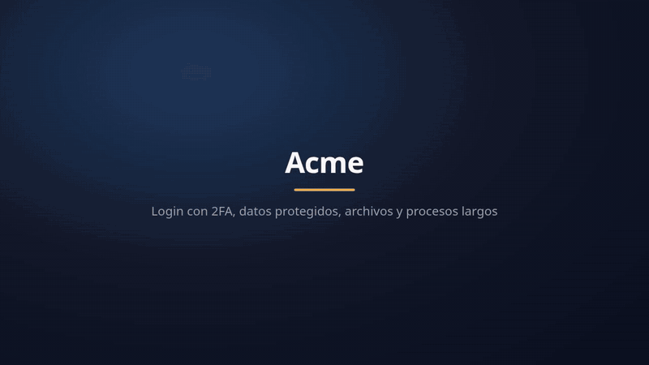

<h1 align="center">
  <picture>
    <source media="(prefers-color-scheme: dark)" srcset="brand/logo-horizontal-dark.svg">
    
  </picture>
</h1>

[](https://www.npmjs.com/package/tourwright)
[](https://github.com/CXmiloxx/tourwright/actions/workflows/ci.yml)
[](LICENSE)
[](docs/AGENTS.md)

**Narrated product tours and how-to videos, without editing.** Click through your app once, or ask your AI
agent for the video: Tourwright writes the script, films a real browser in a studio frame, guides the eye to each
element, speaks with a natural voice and delivers an `.mp4` with captions, chapters and a thumbnail. When the UI
changes, you render again. Built for people *and* AI agents, on any server, from a laptop to a cluster.

*[Leer en español](README.es.md)*

<p align="center">
  <a href="docs/demo/demo.mp4"></a>
  <br><sub>Made by Tourwright from <a href="examples/app.yaml">examples/app.yaml</a>, with nobody at the keyboard. <a href="docs/demo/demo.mp4">▶ Watch it with sound</a> (77 s)</sub>
</p>

```yaml
# tour.yaml
title: Your first invoice
voice: lessac
baseUrl: https://app.example.com
steps:
  - goto: /invoices/new
  - title: { text: Your first invoice, subtitle: Step by step }
  - say: Pick the <b>customer</b> first.
  - click: { role: combobox, name: Customer }
  - say: Then save. That's it.
  - click: { role: button, name: Save }
```

```bash
tourwright render tour.yaml        # → videos/tour/tour.mp4 (+ captions.srt/.vtt, .jpg, .json)
```

## Why Tourwright

Screen recorders (Loom) and click-through demo tools (Arcade, Supademo, Scribe) need a person to record, and
every redesign means recording again. Tourwright videos are **code**:

| | Screen recorder | Demo SaaS | **Tourwright** |
|---|---|---|---|
| Re-record after a UI change | by hand | by hand | `tourwright render` |
| Knows when a video went stale | no | no | `tourwright check` in CI names the broken step and the fix |
| Narration | your voice, retakes | none or extra | text-to-speech in many voices, offline or online |
| Same tour for 50 customers or languages | 50 recordings | 50 demos | one script with `{{variables}}` |
| Personal data on screen | edit it out | edit it out | `mask` replaces it with invented data |
| Lives in | a vendor's cloud | a vendor's cloud | your git repo, your servers; MIT |
| AI agents can make one | no | no | MCP server and a Claude Code plugin |

## What you get

- **Browser walkthroughs**: real Chromium, a smooth animated cursor, click ripples, highlights, spotlights,
  callout bubbles, camera zoom, drag and drop, blurred personal data, title cards and captions in your colors
  and logo.
- **Guided focus**: the tour an app shows the first time you open it. Everything dims but the element, a
  ring marks it, a bubble with a `2/4` badge explains it and the camera pushes in, right on the word the
  voice is saying.
- **Narrated slides**: title cards, images (with slow pan/zoom), HTML, crossfades. No website needed.
- **Voices, your choice**: [Pocket TTS](https://github.com/kyutai-labs/pocket-tts) (offline, open, natural:
  `tourwright install --pocket`), [Piper](https://github.com/rhasspy/piper) (offline, open source, light),
  Microsoft Edge neural voices, any OpenAI-compatible TTS server (OpenAI, Kokoro, LocalAI…), or your own
  command. Every sentence is cached: re-rendering never re-synthesizes.
- **A cast, and how each line is said**: several voices per video, speed, pitch and volume per line on any
  engine, exact pauses (`[[1s]]`), a pronunciation dictionary, sound presets (warm, radio, podcast…), click,
  typing and other sound effects, music with fades.
- **Scripts that scale with you**: variables (`{{name}}`, also from the CLI or the API), reusable blocks,
  repeats, conditions and steps that may fail. One script, many videos.
- **Plugins**: new actions, TTS engines and voices as small modules ([docs/PLUGINS.md](docs/PLUGINS.md)).
- **Tight edits, automatically**: page loads, slow waits and voice synthesis are cut out; narration never
  overlaps; background music ducks under the voice.
- **Deliverables**: H.264/AAC `.mp4` with chapters and the captions drawn on it, `.srt`, `.vtt`, thumbnail and a JSON
  manifest (duration, chapters, captions) for automation.
- **Four ways in**: CLI, HTTP API with job queue and webhooks, MCP server for AI agents, Node library.
- **Scales out**: stateless API replicas, any number of workers on any number of servers, Redis/BullMQ
  queue, S3-compatible storage. Or a single process with a folder, on a Raspberry Pi.

## Install

### Docker (recommended)

```bash
docker run --rm -v "$PWD:/work" -w /work ghcr.io/cxmiloxx/tourwright render examples/slides.yaml --out videos/
```

A full service (API + 2 workers + Redis):

```bash
cp .env.example .env    # set TOURWRIGHT_API_TOKENS
docker compose up -d --build
docker compose up -d --scale worker=6
```

### From npm (quickest to try)

Node.js 22+, on Linux, macOS or Windows:

```bash
npm install -g tourwright
tourwright install                    # ffmpeg, Piper + voices, edge-tts, Chromium (no root)
tourwright install --plan             # only show what it would use from this PC and what it would download
tourwright config set quality fullhd  # your own defaults: quality, voice, fps… (tourwright config lists them)
tourwright record https://app.example.com --out tour.yaml   # do the tour by hand: you get the script and the video
tourwright guide tour.yaml --open     # the same tour as a step-by-step guide with screenshots (HTML, PDF, Markdown)
tourwright narrate tour.yaml --write  # your AI (Claude, OpenAI, Ollama) rewrites the narration from the screens
tourwright translate tour.yaml --to en  # the same video in English (or pt, fr, de, it): tour.en.yaml
tourwright check videos/*.yaml        # which videos broke after a deploy, at which step, and the fix
tourwright fix tour.yaml --write      # puts the new targets in the script
tourwright render tour.yaml --step 7  # film one step with its voice, without the whole video
tourwright install --pocket           # + Pocket TTS: natural offline voices (about 1 GB)
tourwright clean                      # what each part takes on disk; removes downloads and leftovers
tourwright doctor                     # what works on this machine
```

Without installing anything globally: `npx tourwright <command>`. With pnpm: `pnpm add -g tourwright`
(on 2.0.0, add `--no-optional`).

The Redis queue and Claude for `narrate` are optional: install `bullmq ioredis` or `@anthropic-ai/sdk` next to
Tourwright when you use them (`npm install -g bullmq ioredis`). The Docker image already has them.

### Without Docker (Linux, macOS, Windows)

Node.js 22+. `tourwright install` puts ffmpeg, Piper, voices, edge-tts and Chromium in `TOURWRIGHT_HOME`, with no
root or admin rights; what the system already has is kept.

```bash
git clone https://github.com/CXmiloxx/tourwright && cd tourwright
./scripts/install.sh           # Linux / macOS (Windows: powershell -ExecutionPolicy Bypass -File scripts\install.ps1)
node bin/tourwright.js doctor  # what works on this machine
npm link                       # optional: the `tourwright` command
```

Each piece is looked for on the PC first and only downloaded when it is missing:

| | Linux (x64, arm64) | macOS (Intel, Apple Silicon) | Windows 10/11 (x64, ARM) |
|---|---|---|---|
| Chromium | Chrome, Edge or Chromium (apt, dnf, pacman, Raspberry Pi OS), else downloaded | Chrome, Edge or Chromium, else downloaded | Chrome or Edge, else downloaded |
| ffmpeg | `PATH`, Homebrew, Nix, else downloaded | Homebrew, MacPorts, Nix, else `brew install ffmpeg` | `PATH`, winget, scoop, Chocolatey, `C:fmpeg`, else downloaded |
| Piper (offline voices) | `PATH`, pip, pipx, conda, else downloaded | `PATH`, pip, pipx, conda, else `piper-tts` | `PATH`, pip, pipx, conda, else downloaded |
| Piper voices | Hugging Face cache, `TOURWRIGHT_PIPER_VOICE_DIRS`, else downloaded | same | same |
| edge-tts (Microsoft voices) | `PATH`, pip, pipx, conda, else installed | same | same |
| Python (for edge-tts, Pocket, Whisper) | the system's 3.10–3.13, else 3.12 is downloaded | same | same (not the Microsoft Store stub) |
| Capture | `screen` with Xvfb (sharpest), else `screencast` | `screencast` | `screencast` |

Also reused: a Chromium left by another Playwright or Puppeteer version, and `CHROME_PATH`, `CHROME_BIN` or
`PUPPETEER_EXECUTABLE_PATH`. Snap and Flatpak browsers are skipped (their sandbox blocks Playwright).
`TOURWRIGHT_SYSTEM_BROWSER=0` always uses Playwright's own Chromium. `tourwright doctor` shows what was found.

Nothing is installed on the system: what is downloaded lives in one folder (`TOURWRIGHT_HOME`), and the Python
packages run in a virtual environment, so yours is never changed. To uninstall, delete that folder.

`Xvfb` (`apt install xvfb`, Linux only) gives the sharpest capture; without it Tourwright records headless
(screencast), which works everywhere Chromium runs. Clients of the HTTP API or MCP can be on any system.

## Use it

From a site to a video, without writing selectors by hand:

```bash
tourwright explore https://app.example.com/login --draft app.yaml   # asks for the login, writes the script
tourwright render app.yaml --dry-run                               # checks every step in seconds
tourwright render app.yaml --open                                  # the video, in ./videos/app/
```

The draft goes through every section of the site with narration taken from its pages; edit it in your words.
Credentials are asked for once, never shown and never written in the script (`tourwright secret list`;
`tourwright forget` deletes them).

```bash
tourwright init video.yaml                  # an example script
tourwright validate video.yaml
tourwright render video.yaml --dry-run      # runs every step fast: tests selectors, no voice/video
tourwright render video.yaml --safe         # the same, pressing nothing: no real sign-up, payment or SMS
tourwright render video.yaml --keep         # keeps the recording: tourwright recompose videos/video remakes it without the browser
tourwright render video.yaml --quality fullhd --voice salome --out out/
tourwright voices                           # voices available here
tourwright install-voice en_GB-alba-medium  # any voice from huggingface.co/rhasspy/piper-voices
tourwright say "Hello there" --voice lessac --out hello.wav
```

The script format, every action and the voices: **[docs/SCRIPTS.md](docs/SCRIPTS.md)**.
JSON Schema for editors and agents: [`schema/script.schema.json`](schema/script.schema.json).

### HTTP API

```bash
TOURWRIGHT_API_TOKENS=secret tourwright serve --worker --port 4700
curl -X POST localhost:4700/v1/jobs -H 'authorization: Bearer secret' -H 'content-type: application/json' \
  -d '{"script": {"type": "slides", "slides": [{"title": "Hello", "say": "Hello from the API."}]}}'
curl localhost:4700/v1/jobs/<id> -H 'authorization: Bearer secret'   # → status, result, download links
```

Endpoints, assets, webhooks: [docs/API.md](docs/API.md).

### AI agents (MCP)

Claude Code, as a plugin (the MCP server plus a skill that writes, checks and renders the script):

```text
/plugin marketplace add CXmiloxx/tourwright
/plugin install tourwright@tourwright
```

Any other MCP client (Claude Desktop, Cursor, VS Code…):

```json
{ "mcpServers": { "tourwright": { "command": "tourwright", "args": ["mcp"] } } }
```

Tools: `tourwright_guide`, `tourwright_voices`, `tourwright_validate`, `tourwright_check`, `tourwright_render`, `tourwright_job`,
`tourwright_jobs`, `tourwright_delete_job` (and
`tourwright_render_file` with `TOURWRIGHT_MCP_ALLOW_FILES=true`). Point it at a remote API with `TOURWRIGHT_API_URL`
and `TOURWRIGHT_API_TOKEN`. Details: [docs/AGENTS.md](docs/AGENTS.md).

### GitHub Action

Re-render your tours on every release, or fail the build when a deploy broke one:

```yaml
- uses: CXmiloxx/tourwright@v2
  with:
    scripts: videos/*.yaml
    command: check            # or render: the videos become a workflow artifact
  env:
    TOURWRIGHT_SECRET_APP_PASSWORD: ${{ secrets.APP_PASSWORD }}
```

Inputs: `scripts`, `command`, `out`, `voice`, `quality`, `voices`, `version`, `upload` ([action.yml](action.yml)).

### Node library

```js
import { loadFile, render } from 'tourwright'
const result = await render(await loadFile('tour.yaml'), { out: 'videos/', quality: 'hd' })
console.log(result.paths.video, result.duration, result.chapters)
```

## Scaling

| Size | Setup |
|---|---|
| One machine | `tourwright serve --worker` — local folder queue, files on disk |
| One big machine | `docker compose up --scale worker=N` — Redis queue, shared volume |
| Many machines | API replicas behind a load balancer, workers anywhere, same Redis + S3 bucket |
| Kubernetes | [`deploy/kubernetes/tourwright.yaml`](deploy/kubernetes/tourwright.yaml), workers autoscaled |

Each worker renders `TOURWRIGHT_CONCURRENCY` videos at a time (one Chromium + ffmpeg each: plan ~1–2 CPU and
~1 GB RAM per video at 720p). Workers run at low CPU and disk priority so a shared server stays responsive.
More: [docs/DEPLOYMENT.md](docs/DEPLOYMENT.md) · configuration: [docs/CONFIGURATION.md](docs/CONFIGURATION.md).

## Security

API jobs run in a sandbox: data-only scripts (no JavaScript), files limited to the job's assets, optional
host allowlist and private-network blocking, secrets off by default, per-token job isolation, signed
download links. Read [SECURITY.md](SECURITY.md) before exposing the API to untrusted clients.

## License

MIT. Piper voices have their own licenses (see each voice's model card); Edge voices are a Microsoft
online service, check its terms for your use.
